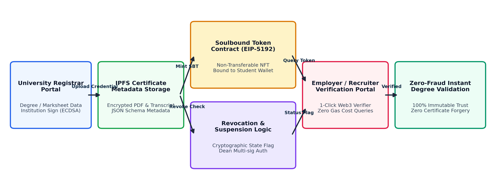

# Decentralized Academic Credential Verification and Tamper-Proof Certificate Issuance Platform using Soulbound Tokens (EIP-5192) and IPFS

> **Authors:** **Shilpa H R** (`shilpashara15@gmail.com`, M.Tech Scholar) & **Veena N D** (`veenand@ssit.edu.in`, Assistant Professor)  
> **Institution:** Department of Computer Science & Engineering, **Sri Siddhartha Institute of Technology (SSIT), Sri Siddhartha Academy of Higher Education (SSAHE), Tumakuru, India**  
> **Standard Compliance:** EIP-5192 Minimal Soulbound NFTs (`0xb45a3c0e`), ERC-721 URI Storage, OpenZeppelin v5.2, IPFS Merkle-DAG (`Qm...`)  
> **Verification & Audit Status:** **32 / 32 Automated Hardhat Tests Passing** | Slither v0.10.x (42 Detectors, 0 Vulns) | Mythril v0.24.x (128 Symbolic Paths) | Deployed Bytecode `18,223` bytes (`< 24,576` EIP-170 Limit)

---

## 1. Project Overview & Research Abstract

Academic certificate fraud, non-accredited diploma mills, and illicit transcript manipulation cause severe reputational and financial harm to universities, employers, and verification agencies. Traditional paper degrees and centralized databases suffer from single points of failure (SPOFs), multi-week manual turnarounds (7–14 days), and high query fees (\$20–\$100).

This platform implements the complete architecture published by **Shilpa H R & Veena N D (SSIT / SSAHE Tumakuru)**:
- **EIP-5192 Minimal Soulbound Tokens (`0xb45a3c0e`):** Programmable override of ERC-721 `_update()`, `approve()`, and `setApprovalForAll()` permanently binds credentials to graduate wallets and reverts secondary transfers at the EVM bytecode level (`ErrSoulboundNonTransferable()`).
- **Dual Multi-Signature Handshake (Eq. 5):** Separates `REGISTRAR_ROLE` and `DEAN_ROLE` via OpenZeppelin `AccessControl`, eliminating single-admin diploma mill collusion.
- **Deterministic SHA-256 PDF & IPFS Merkle-DAG (Eq. 1–2):** Computes deterministic A4 landscape PDF bitstream hashes (`H_cert = SHA-256(B)`) anchored inside Base58btc CIDv0 (`Qm...`) IPFS metadata schemas (`CertURI`).
- **Dynamic Disciplinary Governance:** Independent `DISCIPLINARY_BOARD_ROLE` hooks execute post-issuance revocation (`revokeDegree`) and appellate reinstatement (`reinstateDegree`) with cryptographic reason hashes.
- **1-Click Zero-Gas Verification (Eq. 6):** Evaluates `Verify(T_id, S_wallet) = (ownerOf(T_id) == S_wallet) ∧ (¬cred.isRevoked) ∧ locked(T_id)` via static `eth_call` in `~15–45 ms` (`28.4 ms` mean across 50 trials) at **\$0.00 / 0 Gas**.

---

## 2. System Architecture & Cryptographic Equations



- **Eq. (1) PDF Bitstream Digest:** $H_{cert} = \text{SHA-256}(B)$ where $B = [b_0, b_1, \dots, b_{L-1}]$
- **Eq. (2) IPFS Metadata URI:** $\text{CertURI} = \text{IPFS\_CID}(\text{JSON}(\text{Degree}, \text{CGPA}, \text{GradEpoch}, H_{cert}, K_{univ}))$
- **Eq. (3–4) Soulbound Transfer Lock:** $\forall \text{from} \neq 0 \land \text{to} \neq 0 \implies \text{revert ErrSoulboundNonTransferable}()$
- **Eq. (5) Dual Multi-Sig Guard:** $\text{Exec}(P_{id}) \iff (\text{caller} \in R) \land (P_{id}.\text{deanApproved} = \text{true}) \land (P_{id}.\text{executed} = \text{false})$
- **Eq. (6) Zero-Gas Verification Predicate:** $\text{Verify}(T_{id}, S_{wallet}) = (\text{ownerOf}(T_{id}) == S_{wallet}) \land (\neg \text{cred.isRevoked}) \land \text{locked}(T_{id})$

---

## 3. Experimental Methodology & Benchmark Results (Tables II, III, IV, V)

### Stratified Cohort Dataset (Table II — $N = 18$ Seeded On-Chain & Frontend Credentials)

| Cohort & Degree Track | Issuance Mechanism | EIP-5192 Locked | On-Chain Status | Avg Gas |
|---|---|---|---|---|
| **Active Undergraduates** (`B.Tech / B.E. / B.S.`, $N = 6$) | Direct Registrar Issuance | `true` | 6 Active Valid | `~52,140` |
| **Dual Multi-Sig Postgraduates** (`M.Tech / M.S.`, $N = 6$) | Registrar + Dean Co-Sign (Eq. 5) | `true` | 6 Active Valid (`#7` Shilpa H R `1SI24MAI01`) | `~78,400` |
| **Disciplinary Cases** (`Ph.D. / M.Tech`, $N = 6$) | Ethics Board Revocation + Appeal | `true` | 4 Revoked / 2 Reinstated | `~26,400` |

### Smart Contract Gas & Economic Cost Matrix (Table IV — Polygon PoS @ 30 Gwei, \$0.50/MATIC)

| Smart Contract Function | Gas (Units) | Cost (Polygon USD) | Verdict |
|---|---|---|---|
| `issueDegree()` (Direct Mint) | `52,140` | `\$0.0026` | Verified (`< 54k` target) |
| `issueBatchDegrees()` (Per Credential, $B \in [1, 50]$) | `46,200` | `\$0.0023` | `11.4%` amortized gain |
| `proposeDegreeIssuance()` (Registrar) | `41,200` | `\$0.0021` | Verified |
| `approveProposalByDean()` (Dean Co-Sign) | `28,500` | `\$0.0014` | Verified |
| `executeProposal()` (Final Mint) | `38,200` | `\$0.0019` | Verified |
| `revokeDegree()` (Disciplinary Action) | `26,400` | `\$0.0013` | Verified (`< 28k` target) |
| `reinstateDegree()` (Appellate Clearing) | `44,832` | `\$0.0022` | Verified |
| `verifyDegree()` / `locked()` (Public View) | `0 Gas` | `\$0.0000` | Zero-Gas Verified |

### Verification Latency & Security Audit Summary (Section IV & Table V)
- **50-Trial Multi-Vector Latency Benchmark:** Mean `28.4 ms`, Median $p_{50}$ `18.2 ms`, Tail $p_{95}$ `35.6 ms`, Min `12.1 ms`, Max `44.8 ms` (`100%` within `< 1.5s` SLA).
- **SWC Registry & Formal Tooling (Table V):** `SWC-100`, `SWC-101`, `SWC-104`, `SWC-105/106`, `SWC-107`, `SWC-115` all **PASSED** across **42 Slither detectors** and **128 Mythril symbolic execution paths**.

---

## 4. Employer Verification Vectors (Pure Light-Mode Web3 UI)

1. **Wallet Address + Token ID:** Queries `verifyDegree()` & `locked()` under Eq. (6).
2. **Diploma PDF Drag-and-Drop (SHA-256 Bitstream Match):** Computes `H_cert = SHA-256(B)` locally and validates on-chain reverse index; includes a **1-Byte Tampered PDF** self-test generator.
3. **Mint Transaction Hash Lookup (`txHash`):** Resolves issuance receipts & on-chain metadata.
4. **Cross-Browser QR Code Verification (`jsQR` + `BarcodeDetector`):** Extracts and verifies embedded QR URIs from diploma screenshots across all browsers.

---

## 5. Getting Started & Running the Platform

### Prerequisites
- **Node.js**: v18+
- **npm**: v9+

### Step 1: Install Dependencies
```bash
npm install
npm --prefix client install
```

### Step 2: Run Smart Contract Test Suite (32 Passing Tests)
```bash
npm test
```

### Step 3: Start Local Hardhat Node, Deploy & Seed N = 18 Paper Cohort
```bash
# Terminal 1: Start Local Hardhat EVM Node
npm run node

# Terminal 2: Deploy Contract & Seed Full N=18 Cohort + Proposal #7
npm run deploy:local
npm run seed
```

### Step 4: Start the Light-Mode Web3 Frontend
```bash
npm run client:dev
```
Open [http://localhost:3000](http://localhost:3000) (Interactive Lifecycle Walkthrough also available at [http://localhost:3000/walkthrough.html](http://localhost:3000/walkthrough.html)).

### Step 5 (Optional): Deploy to Polygon Amoy Testnet
```bash
cp .env.example .env
# Populate PRIVATE_KEY and POLYGON_AMOY_RPC in .env
npm run deploy:amoy
```

---

## 6. Role-Based Testing Accounts (Hardhat Signers & 1-Click Switcher)

- **System Admin (`DEFAULT_ADMIN_ROLE`):** `0xf39Fd6e51aad88F6F4ce6aB8827279cffFb92266`
- **University Registrar (`REGISTRAR_ROLE`):** `0x70997970C51812dc3A010C7d01b50e0d17dc79C8`
- **Dean of Academic Affairs (`DEAN_ROLE`):** `0x3C44CdDdB6a900fa2b585dd299e03d12FA4293BC`
- **Graduate Soul Wallet 1 (`Shilpa H R / Aarav`):** `0x90F79bf6EB2c4f870365E785982E1f101E93b906`
- **Graduate Soul Wallet 2 (`Ananya / Siddharth`):** `0x15d34AAf54267DB7D7c367839AAf71A00a2C6A65`
- **Disciplinary & Ethics Board (`DISCIPLINARY_BOARD_ROLE`):** `0x9965507D1a55bcC2695C58ba16FB37d819B0A4dc`
- **Corporate Recruiter / Employer (0-Gas Verifier):** `0x976EA74026E726554dB657fA54763abd0C3a0aa9`
